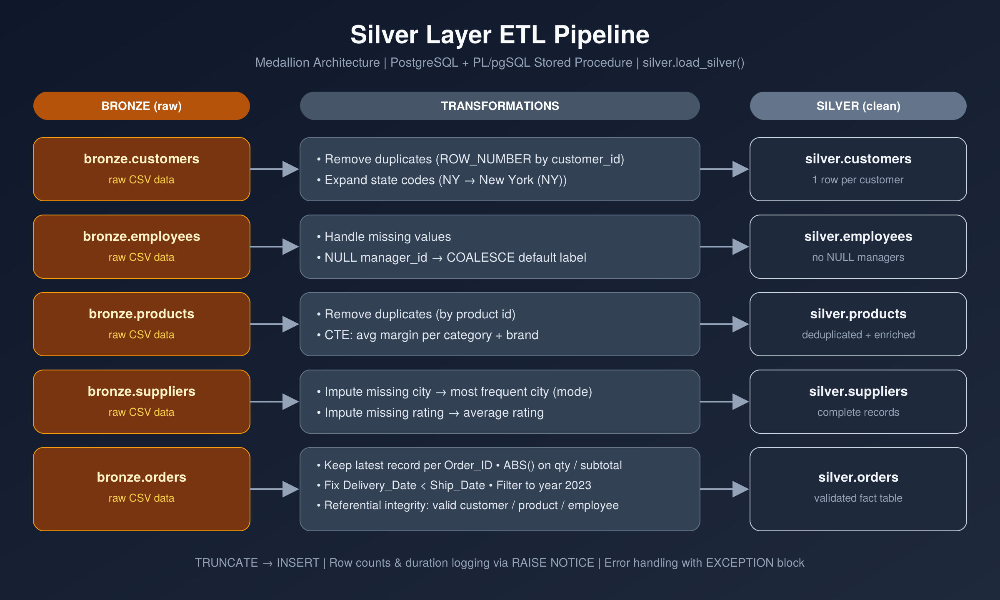
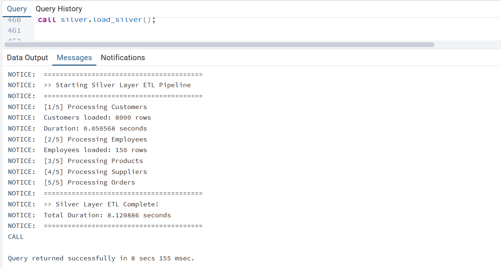
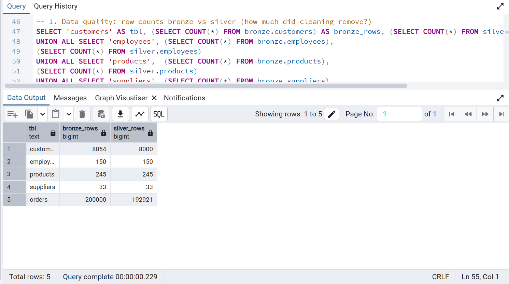
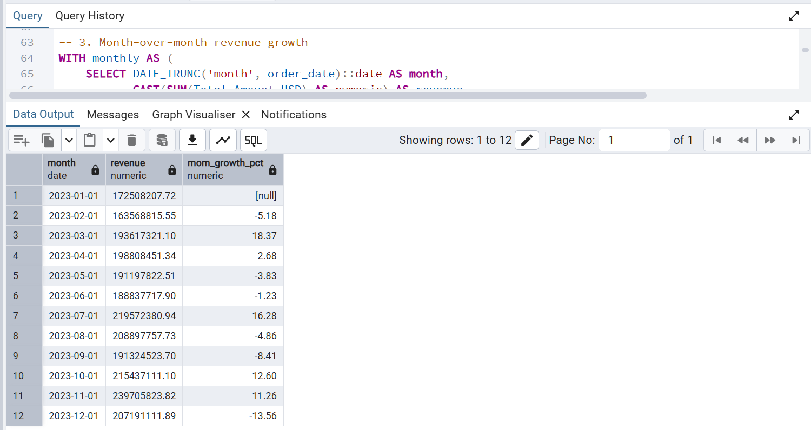

# Sales Data Warehouse: Bronze → Silver ETL & Advanced SQL Analysis

A SQL-first, database-focused project. Raw B2B sales data is loaded into a **Bronze** layer, cleaned and validated into a **Silver** layer using a single PL/pgSQL stored procedure, and then analysed with advanced SQL (CTEs, window functions, aggregations).

**Stack:** PostgreSQL · PL/pgSQL · SQL (CTEs, window functions)

---

## Overview

| | |
|---|---|
| **Domain** | B2B sales (software licenses, laptops, desks, office chairs, printers, monitors, keyboards) |
| **Period** | Calendar year 2023 |
| **Tables** | `customers`, `employees`, `products`, `suppliers`, `orders` |
| **Raw volume** | 200,000 orders · 8,064 customers · 245 products · 150 employees · 33 suppliers |
| **Result** | Clean, validated Silver layer + a set of analytical queries answering business questions |

The goal is to show the full path from messy raw data to trustworthy, analysis-ready tables, entirely inside the database.

---

## Architecture



Data follows the **medallion architecture**:

- **Bronze**: raw data, loaded as-is (duplicates, missing values, inconsistent codes).
- **Silver**: cleaned, deduplicated, standardized and validated tables, produced by `silver.load_silver()`.

## Data Model


| Relationship | Type |
|---|---|
| `customers` → `orders` | one-to-many |
| `employees` → `orders` (sales rep) | one-to-many |
| `products` → `orders` | one-to-many |
| `suppliers` → `products` | one-to-many |
| `employees` → `employees` (manager) | one-to-many (self reference) |

---

## What the ETL Does

The whole pipeline runs with one call: `CALL silver.load_silver();`

| Table | Transformations |
|---|---|
| **customers** | Remove duplicates with `ROW_NUMBER()` by `customer_id`; expand US state codes (e.g. `NY` → `New York (NY)`) |
| **employees** | Handle missing `manager_id` values with `COALESCE` |
| **products** | Remove duplicates by product id; CTE computing the average margin per category and brand |
| **suppliers** | Impute missing `city` with the most frequent city (mode); impute missing `supplier_rating` with the average rating |
| **orders** | Keep the latest record per `order_id`; `ABS()` on negative quantity/subtotal; fix delivery dates earlier than ship dates (ship date + 5 days); keep only valid 2023 orders with quantity ≠ 0; enforce referential integrity (customer, product and sales employee must exist in Silver) |

The procedure also logs row counts and step duration with `RAISE NOTICE` and handles failures with an `EXCEPTION` block.

### Data quality results

| Table | Bronze rows | Silver rows | Removed |
|---|---:|---:|---:|
| customers | 8,064 | 8,000 | 64 |
| employees | 150 | 150 | 0 |
| products | 245 | 245 | 0 |
| suppliers | 33 | 33 | 0 |
| orders | 200,000 | 192,921 | 7,079 (3.5%) |

Final validation checks on `silver.orders` all return **0**: no delivery before shipping, no zero quantities, no duplicate orders.

---

## Analysis & Key Findings

All queries are in [`sql/analysis_queries.sql`](src/analysis_queries.sql).

### 1. Monthly revenue and growth

Techniques: `DATE_TRUNC`, `LAG()` window function, `NULLIF`.

| Month | Orders | Revenue ($M) | MoM growth |
|---|---:|---:|---:|
| Jan | 13,273 | 172.51 | n/a |
| Feb | 13,443 | 163.57 | -5.18% |
| Mar | 15,623 | 193.62 | +18.37% |
| Apr | 15,210 | 198.81 | +2.68% |
| May | 15,511 | 191.20 | -3.83% |
| Jun | 15,516 | 188.84 | -1.23% |
| Jul | 17,378 | 219.57 | +16.28% |
| Aug | 17,486 | 208.90 | -4.86% |
| Sep | 15,401 | 191.32 | -8.41% |
| Oct | 17,381 | 215.44 | +12.60% |
| Nov | 19,305 | 239.71 | +11.26% |
| Dec | 17,394 | 207.19 | -13.56% |

- Total revenue for 2023 is about **$2.39B** across 192,921 orders.
- **November is the peak** ($239.7M), **February the weakest** ($163.6M).
- Clear growth spikes in **March (+18.4%)**, **July (+16.3%)** and **Oct–Nov**.
- December's drop should be read together with the load filter (orders are loaded up to 2023-12-28).

### 2. Top 10 customers by revenue

| Customer | Segment | Orders | Revenue |
|---|---|---:|---:|
| Home Depot (CUST0002363) | Enterprise | 31 | $3.42M |
| Abbott Laboratories | Enterprise | 25 | $3.07M |
| Rose-Parker | Mid-Market | 28 | $2.74M |
| Ramirez, Herrera and Johnson | Mid-Market | 28 | $2.43M |
| Chevron Corporation | Enterprise | 28 | $2.31M |
| Williams LLC | Mid-Market | 39 | $2.22M |
| Good, Arellano and Garcia | Mid-Market | 29 | $2.22M |
| Netflix Inc | Enterprise | 27 | $2.21M |
| Stevens, Powers and Vazquez | Small Business | 36 | $2.18M |
| Home Depot (CUST0001763) | Enterprise | 30 | $2.17M |

- Enterprise and Mid-Market customers make up 9 of the top 10.
- **Home Depot appears twice under two different customer IDs**, a possible duplicate-entity issue worth a master-data review.

### 3. Revenue by region and segment ($M)

| Region | Enterprise | Mid-Market | Small Business |
|---|---:|---:|---:|
| West | 107.93 | **178.10** | 156.39 |
| Southeast | 132.59 | 173.62 | **176.78** |
| Midwest | 116.05 | **170.96** | 160.82 |
| Northeast | 124.62 | 158.27 | **167.32** |
| Southwest | 126.74 | 147.22 | **162.52** |
| International | 130.72 | n/a | n/a |

- **West / Mid-Market** is the single biggest revenue cell ($178.1M).
- Enterprise is the lowest-revenue segment in every domestic region, while Mid-Market and Small Business drive most of the revenue.
- The International region only has Enterprise customers.

### 4. Products and categories

**Top 5 products by revenue**

| Product | Category | Units | Revenue ($M) |
|---|---|---:|---:|
| Microsoft 365 Business | Software_Licenses | 39,185 | 83.08 |
| Adobe Creative Business | Software_Licenses | 40,062 | 80.82 |
| AutoCAD Business | Software_Licenses | 30,737 | 80.44 |
| AutoCAD Cloud | Software_Licenses | 31,076 | 79.94 |
| Salesforce LT | Software_Licenses | 31,380 | 75.74 |

Software licenses take 6 of the top 10 spots, the rest being laptops (Lenovo ThinkPad, Microsoft Surface) and desks (Knoll, Haworth).

**Category performance** (estimated gross profit = subtotal − quantity × unit cost)

| Category | Units | Gross sales ($M) | Est. gross profit ($M) | Margin |
|---|---:|---:|---:|---:|
| Software_Licenses | 336,637 | 697.62 | 103.48 | 14.8% |
| Office_Chairs | 340,329 | 367.55 | 100.72 | 27.4% |
| Desks | 345,622 | 435.12 | 99.90 | 23.0% |
| Laptops | 323,913 | 491.07 | 97.01 | 19.8% |
| Printers | 331,114 | 221.07 | 51.99 | 23.5% |
| Monitors | 329,044 | 177.43 | 44.27 | 25.0% |
| Keyboards | 339,530 | 48.60 | 14.14 | 29.1% |

- Unit volumes are almost equal across categories (about 324K–346K), so revenue differences come from price.
- **Software licenses lead in sales but have the lowest margin (14.8%)**, while **office chairs rank second in profit** thanks to a 27.4% margin. Keyboards have the best margin but the smallest volume of sales.

### 5. Sales rep leaderboard

Techniques: `RANK() OVER (ORDER BY SUM(...) DESC)`.

| Rank | Sales rep | Orders | Revenue ($M) |
|---:|---|---:|---:|
| 1 | Jimmy Oneal | 6,921 | 98.86 |
| 2 | Danielle Rogers | 7,119 | 96.93 |
| 3 | Helen Silva | 6,878 | 95.54 |
| 4 | Laurie Alvarado | 6,797 | 93.06 |
| 5 | Jeremy Espinoza | 6,920 | 91.10 |
| … | … | … | … |
| 28 | Noah Jackson | 6,874 | 74.93 |

- 28 sales reps closed all orders, each with roughly 6,800–7,100 orders.
- The top rep generates about **32% more revenue** than the lowest, despite a similar order count, which means the gap is driven by order value rather than volume.

### 6. Order status

| Status | Orders | Share |
|---|---:|---:|
| Completed | 135,106 | 70.03% |
| Shipped | 28,629 | 14.84% |
| In Transit | 11,738 | 6.08% |
| Processing | 7,752 | 4.02% |
| Cancelled | 5,768 | 2.99% |
| Returned | 3,928 | 2.04% |

Cancellations and returns together are only about **5%** of orders.

### 7. Delivery performance

The average time from shipping to delivery is a steady **5.8–5.9 days** in every month of the year, so delivery performance is very consistent.

### 8. Discount impact

| Discount band | Orders | Avg order value |
|---|---:|---:|
| 0% | 177,594 | $4,803.84 |
| 1–10% | 7,659 | $33,246.00 |
| 11–20% | 7,668 | $167,306.04 |

About **92% of orders have no discount**. Discounts are concentrated in much larger orders, which points to volume-based discounting.

### 9. Supplier performance

| Supplier | Category | Rating | Lead time (days) | Products |
|---|---|---:|---:|---:|
| Oracle | Software | 4.9 | 9 | 12 |
| Salesforce | Software | 4.9 | 11 | 16 |
| Knoll | Furniture | 4.8 | 12 | 6 |
| Kimball International | Furniture | 4.6 | 10 | 3 |
| Office Depot | Office_Supplies | 4.6 | 5 | 10 |

- **Dell Technologies** has the longest lead time (41 days) with a below-average rating (3.7); **Samsung Electronics** is next with 27 days.
- Three suppliers (LG Electronics, HP Inc, 3M Company) show a rating of 4.18, the **imputed average** from the ETL, which confirms the missing-value handling.

---

## SQL Techniques Used

- CTEs for margin calculation and imputation values
- Window functions: `ROW_NUMBER()`, `LAG()`, `RANK()`, `SUM() OVER ()`
- `CASE` expressions for state mapping and discount bands
- Joins, `GROUP BY`, `UNION ALL`, subqueries for referential integrity
- PL/pgSQL: variables, `GET DIAGNOSTICS`, `RAISE NOTICE`, exception handling, timing with `clock_timestamp()`
- `DATE_TRUNC`, `COALESCE`, `NULLIF`

## Repository Structure

```
.
├── README.md
├── dataset/
│   ├── customers.csv                 
│   ├── employees.csv
│   ├── orders.csv                 
│   ├── products.csv        
│   └── suppliers.csv   
└── src/
│    ├──bronze/
│       ├── ddl_database.sql                 # schemas and table definitions
│       ├── load_database.sql         # load_database() procedure
│    ├──silver/
│       ├── ddl_database.sql                 # schemas and table definitions
│       ├── load_database.sql         # load_database() procedure
│   ├──gold/
│       ├── ddl_database.sql 
├── etl_diagram.png
└── er_diagram.png

```

## How to Run

1. Run `ddl.sql` to create the `bronze` and `silver` schemas and tables.
2. Load the raw data into the `bronze` tables.
3. Run `load_silver.sql` to create the procedure, then execute `CALL silver.load_silver();`
4. Run the queries in `analysis_queries.sql`.

### Pipeline run output


## Next Steps

- Add primary and foreign key constraints to the Silver tables in the DDL.
- Connect a BI dashboard to visualize the Gold layer and explore key business metrics.

## Execution Results

### Row Count Comparison: Bronze vs. Silver



### Monthly Revenue Analysis



### Gold Layer: Star Schema

The Gold layer was successfully built on top of the Silver layer using a star schema to support analytical queries and business intelligence reporting.

